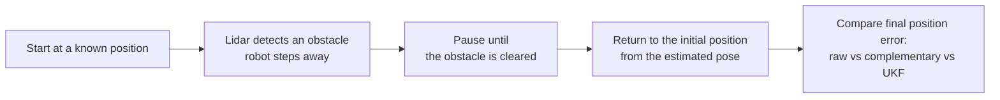

<div align="center">

# Localization of Legged Robots with Sensor Fusion

Localization of a quadruped robot, the Unitree Go2 EDU, by fusing IMU and leg odometry, from a complementary
filter to an Unscented Kalman Filter (UKF). The project includes lab sessions that pass this sensor fusion
knowledge on to future students of our school.

[Final report](docs/final-report-sensor-fusion.pdf) ·
[Presentation slides](docs/presentation-slides.pdf) ·
[SDK quick guide](docs/sdk-quick-guide.pdf) ·
[SDK examples](sdk_examples/) ·
[Lab session](lab-session/)

</div>

---

## At a glance

| | |
|---|---|
| **Challenge** | Localize a legged robot and bring it back to its starting point without vision, using only IMU and leg odometry |
| **Robot** | Unitree Go2 EDU (quadruped) controlled through `unitree_sdk2` over DDS |
| **Filters** | Complementary filter (IMU orientation and position) and Unscented Kalman Filter (IMU + leg odometry) |
| **Language** | C++ (CMake, Eigen, Cyclone DDS through the Unitree SDK) |
| **Context** | Master 1 Robotics and Autonomous Systems, Polytech Nice-Sophia |
| **Timeline** | February to April 2025: project by Rémi Guzzi and Adrien Waeles-Devaux. June 2025: extension by Alexis Xueref (1 to 27 June, internship) |
| **Outcome** | A lab session proposal, SDK programs running on the robot, and a written report |

## Why legged robot localization is challenging

A wheeled robot can integrate wheel encoders. A legged robot cannot rely on one clean sensor:

- the dynamics are nonlinear (swinging legs, turning, jumping),
- feet slip, and contact with the ground is intermittent,
- no single sensor is enough. The accelerometer is noisy and cannot separate gravity from motion, the gyroscope drifts,
  and joint encoders are only meaningful while a foot is on the ground.

The standard answer is **sensor fusion for nonlinear systems**, which is what this project teaches.

## Approach

### Complementary filter

Blends the gyroscope (accurate in the short term, drifts) with the accelerometer (stable in the long term, noisy)
to estimate roll and pitch, with a single tuning parameter (`alpha`).

Its limit: while the robot moves, the accelerometer measures the robot's own acceleration on top of gravity, so the
estimate degrades. It cannot observe yaw or position either. It is in this repository as the **baseline**: simple
enough to run on the robot first, and the reference the UKF has to beat.

### Unscented Kalman Filter

A Kalman filter assumes linear dynamics and Gaussian noise. For a legged robot we use a **UKF** instead of an EKF: it
propagates sigma points through the nonlinear model, so it needs no Jacobians and handles strong nonlinearities and
discontinuities such as foot impacts better.

1. **Sigma points** are sampled around the current state estimate.
2. **Prediction** integrates the IMU (acceleration with gravity removed, angular velocity) to predict velocity,
   orientation and position.
3. **Correction** compares that prediction with leg odometry, computed from forward kinematics while a foot is in contact with the ground.

The state used in the lab is `[x, y, z, roll, pitch, yaw, vx, vy, vz]`. The report details the equations and the design choices.

## The lab session

Students run the same scenario with raw data and with each filter, and compare how close the robot gets back to where it started:



The hypothesis is that filtering lets the robot estimate its trajectory better and return more accurately. The final
position error is the comparison metric.

## Repository layout

| Path | Content |
|---|---|
| [`docs/`](docs/) | Final report, presentation slides, SDK quick guide, Ubuntu setup guide (French), internship report (French) |
| [`sdk_examples/`](sdk_examples/) | Standalone programs: complementary filter, obstacle avoidance, and both combined |
| [`lab-session/`](lab-session/) | `TP1.zip`: headers and sources for the UKF lab session |

## Getting started

You need a Go2 EDU, an Ubuntu computer on the robot's network, and the Unitree SDK.

1. Disable sport mode in the Unitree Go app, otherwise the SDK cannot send commands.
2. Install [`unitree_sdk2`](https://github.com/unitreerobotics/unitree_sdk2) and follow the
   [Unitree quick start](https://support.unitree.com/home/en/developer/Quick_start). The robot is on the Ethernet
   network, and `ifconfig` shows the name of your interface.
3. Build the examples as described in [`sdk_examples/README.md`](sdk_examples/README.md).
4. Run a program with the network interface as its only argument:

```bash
./go2_comp <network_interface>
```

The [SDK quick guide](docs/sdk-quick-guide.pdf) and the [Ubuntu setup guide](docs/ubuntu-setup-guide-fr.pdf)
(French) cover the setup in more detail.

> **Safety.** These programs move a real robot. Use a clear area and keep the remote control within reach: the
> return-to-origin code does not limit speed or distance.

## Limitations

- Position from integrated velocity and acceleration is dead reckoning: it drifts, and the filters reduce it without removing it.
- The lidar was sometimes unreliable (unexpected values or no signal), so the avoidance thresholds are conservative.

## Team

- **Rémi Guzzi** and [**Adrien Waeles-Devaux**](https://github.com/AdrienWaeles): project, report and lab session, in the Master 1 Robotics and Autonomous Systems at Polytech Nice-Sophia
- **Alexis Xueref**: extension of the project in June 2025, during an internship (first-year engineering school in Robotics at Polytech Nice-Sophia): Ubuntu setup guide and a first lab exercise with a correction filter

## References

- [Unitree Go2 developer documentation](https://support.unitree.com/home/en/developer/)
- Phil's Lab, [Sensor Fusion](https://youtu.be/RZd6XDx5VXo)
- R. R. Labbe, [Kalman and Bayesian Filters in Python](https://github.com/rlabbe/Kalman-and-Bayesian-Filters-in-Python)
- ChalmersX, [Sensor Fusion and Non-linear Filtering for Automotive Systems](https://www.edx.org/learn/mechanical-engineering/chalmers-university-of-technology-sensor-fusion-and-non-linear-filtering-for-automotive-systems)
- T. Zhang et al., [Robust State Estimation for Legged Robots with Dual Beta Kalman Filter](https://arxiv.org/abs/2411.11483)

## License

No license is provided for now: all rights reserved.
